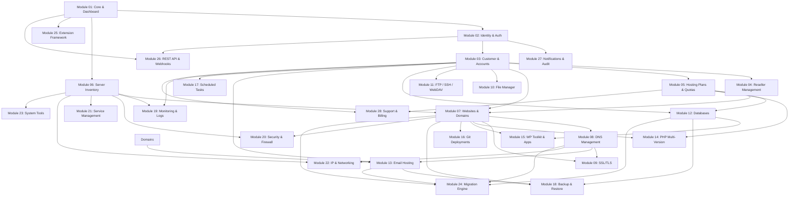

# VortanCP Module Catalog & Integration Specifications

## 1. Modular Monolith Architecture Overview

VortanCP is built as a **Modular Monolith** in Laravel 13. Every hosting capability is encapsulated within an independent module under `app/Modules/{ModuleName}`.

### 1.1 Standard Module Anatomy

Every module follows a strict hexagonal/domain-driven architectural convention:

```
app/Modules/{ModuleName}/
├── Contracts/              # Public interfaces exposed to other modules
├── Actions/                # Single-purpose domain mutation commands
├── Services/               # Domain orchestration & calculation services
├── Models/                 # Eloquent entities owned exclusively by this module
├── Events/                 # Domain events emitted upon state changes
├── Exceptions/             # Domain-specific exceptions
├── Policies/               # Laravel authorization policies
├── Infrastructure/         # Adapters (Server Agent, Drivers, External APIs)
│   ├── Adapters/
│   └── Providers/          # ModuleServiceProvider (registers routes, views, bindings)
├── Livewire/               # User interface layer
│   ├── Pages/              # Full-page route components
│   ├── Components/         # Reusable widgets & telemetry cards
│   ├── Forms/              # Data-entry & validation components
│   ├── Tables/             # Paginated, searchable listing tables
│   └── Modals/             # Action confirmation & operation modals
├── Http/
│   ├── Controllers/        # API v1 endpoints
│   └── Requests/           # Form request validators
├── Database/
│   ├── Migrations/         # Database migrations owned by module
│   └── Seeders/            # Seeders for development & testing
├── Routes/
│   ├── web.php             # Web & Livewire routes
│   └── api.php             # REST API routes
├── Resources/
│   └── views/              # Blade templates (TailAdmin layout extensions)
├── Config/
│   └── module.php          # Module configuration, permissions, menu entries
└── Tests/
    ├── Feature/
    └── Unit/
```

### 1.2 Module Manifest & Registration Contract

Every module provides a `module.json` or `Config/module.php` implementing `Vortan\Core\Contracts\ModuleInterface`:
- **ID & Version:** Unique string (e.g. `vortan.domains`, `1.0.0`)
- **Dependencies:** List of prerequisite modules (e.g. `['vortan.core', 'vortan.servers']`)
- **Required Capabilities:** Host OS or daemon requirements (e.g. `['nginx', 'php-fpm']`)
- **Navigation:** Menu item definitions for Admin, Reseller, and Customer panels
- **Permissions:** Registered permission slugs (e.g. `domains.create`, `domains.delete`)
- **Status:** Enabled / Disabled / Provisioning

---

## 2. Complete Catalog of 28 Modules

### Module 01: Core Platform & Dashboard (`Core`, `Dashboard`)
- **Namespace:** `App\Modules\Core`, `App\Modules\Dashboard`
- **Responsibilities:** Module discovery & registration, global layouts, settings repository, telemetry aggregation, role-aware dashboard widgets (Admin, Reseller, Customer), search palette, notifications hub.
- **Dependencies:** None.
- **Key Models:** `SystemSetting`, `DashboardWidgetPreference`, `Announcement`.
- **Public Services:** `ModuleRegistryService`, `TelemetryAggregatorService`, `BreadcrumbService`.
- **Emitted Events:** `ModuleEnabled`, `ModuleDisabled`, `DashboardWidgetConfigured`.
- **Phased Implementation:** Phase 1 (Base layout & registry) + Phase 2 (Live widgets).

### Module 02: Identity, Authentication & Authorization (`Identity`)
- **Namespace:** `App\Modules\Identity`
- **Responsibilities:** User authentication (session & API), TOTP 2FA, password policies, team delegations, role-based access control (SuperAdmin, ServerAdmin, Reseller, Customer, TeamMember, ReadOnly), session revocation, login throttling.
- **Dependencies:** `Core`.
- **Key Models:** `User`, `Role`, `Permission`, `TwoFactorCredential`, `SessionHistory`, `TeamMembership`.
- **Public Services:** `AuthenticationService`, `TwoFactorService`, `AuthorizationService`.
- **Emitted Events:** `UserLoggedIn`, `UserFailedLogin`, `PasswordResetCompleted`, `RoleAssigned`.
- **Phased Implementation:** Phase 1.

### Module 03: Customer & Account Management (`Accounts`)
- **Namespace:** `App\Modules\Accounts`
- **Responsibilities:** Customer organizations/clients, hosting accounts (sandboxes), account status (Active, Suspended, Locked, Terminated), system user mappings, account ownership transfers, customer contact details.
- **Dependencies:** `Core`, `Identity`.
- **Key Models:** `Customer`, `HostingAccount`, `AccountSuspensionHistory`.
- **Public Services:** `HostingAccountService`, `AccountSuspensionService`.
- **Emitted Events:** `HostingAccountCreated`, `HostingAccountSuspended`, `HostingAccountTerminated`.
- **Phased Implementation:** Phase 2.

### Module 04: Reseller Management (`Resellers`)
- **Namespace:** `App\Modules\Resellers`
- **Responsibilities:** Reseller entity management, resource allocation pools (disk, bandwidth, domains, mailboxes), customer hierarchy tree, reseller ACL delegation, custom branding assets, reseller usage reports.
- **Dependencies:** `Core`, `Identity`, `Accounts`.
- **Key Models:** `Reseller`, `ResellerResourceAllocation`, `ResellerBranding`.
- **Public Services:** `ResellerPoolService`, `ResellerHierarchyService`.
- **Emitted Events:** `ResellerPoolAllocated`, `ResellerExceededLimitAlert`.
- **Phased Implementation:** Phase 2.

### Module 05: Hosting Plans, Subscriptions & Feature Entitlements (`HostingPlans`)
- **Namespace:** `App\Modules\HostingPlans`
- **Responsibilities:** Hosting packages, add-on plans, customer subscriptions, quota enforcement engine (`EntitlementService`), plan upgrade/downgrade, custom subscription overrides.
- **Dependencies:** `Core`, `Accounts`.
- **Key Models:** `HostingPlan`, `PlanFeatureLimit`, `Subscription`, `SubscriptionOverride`.
- **Public Services:** `EntitlementService` (central quota gatekeeper for all modules), `SubscriptionLifecycleService`.
- **Emitted Events:** `SubscriptionCreated`, `SubscriptionUpgraded`, `QuotaExceededNotice`.
- **Phased Implementation:** Phase 2.

### Module 06: Server Inventory & Server Management (`Servers`)
- **Namespace:** `App\Modules\Servers`
- **Responsibilities:** Server node registration, connection secrets (mTLS / API tokens), daemon heartbeat, server capability matrix, hardware telemetry, server groups, account placement algorithm.
- **Dependencies:** `Core`.
- **Key Models:** `Server`, `ServerCapability`, `ServerMetricSample`, `ServerGroup`.
- **Public Services:** `ServerNodeService`, `NodeConnectivityService`, `AccountPlacementService`.
- **Emitted Events:** `ServerNodeRegistered`, `ServerHeartbeatLost`, `ServerMaintenanceToggled`.
- **Phased Implementation:** Phase 2.

### Module 07: Website & Domain Hosting (`Websites`, `Domains`)
- **Namespace:** `App\Modules\Websites`, `App\Modules\Domains`
- **Responsibilities:** Primary domains, addon domains, subdomains, domain aliases, document roots, Nginx/Apache virtual host configurations, redirects (301/302), custom error pages, directory indexing, HTTP/HTTPS binding.
- **Dependencies:** `Core`, `Accounts`, `Servers`, `HostingPlans`.
- **Key Models:** `Domain`, `VirtualHost`, `DomainRedirect`, `CustomErrorPage`.
- **Public Services:** `DomainProvisioningService`, `VirtualHostCompilerService`.
- **Emitted Events:** `DomainCreated`, `VirtualHostRecompiled`, `DomainDeleted`.
- **Phased Implementation:** Phase 2.

### Module 08: DNS Management (`Dns`)
- **Namespace:** `App\Modules\Dns`
- **Responsibilities:** Authoritative DNS zones, record management (A, AAAA, CNAME, MX, TXT, SRV, CAA, NS, PTR, SOA), DNSSEC signing and key rollover, zone templates, secondary DNS clustering.
- **Dependencies:** `Core`, `Domains`, `Servers`.
- **Key Models:** `DnsZone`, `DnsRecord`, `DnsSecKey`, `DnsClusterNode`, `DnsZoneTemplate`.
- **Public Services:** `DnsRecordService`, `DnssecService`, `DnsClusterSyncService`.
- **Emitted Events:** `DnsZoneCreated`, `DnsRecordUpdated`, `DnsZonePublished`.
- **Phased Implementation:** Phase 2.

### Module 09: SSL/TLS Management (`Ssl`)
- **Namespace:** `App\Modules\Ssl`
- **Responsibilities:** Automatic ACME certificate generation (Let's Encrypt / ZeroSSL), HTTP-01 and DNS-01 verification, commercial certificate upload & validation, certificate assignment to vhosts, automated renewal daemon, HTTPS enforcement.
- **Dependencies:** `Core`, `Domains`, `Websites`, `Dns`.
- **Key Models:** `SslCertificate`, `SslOrder`, `AcmeChallengeToken`.
- **Public Services:** `AcmeClientService`, `CertificateValidationService`, `SslDeploymentService`.
- **Emitted Events:** `CertificateIssued`, `CertificateRenewed`, `CertificateExpiringAlert`.
- **Phased Implementation:** Phase 2.

### Module 10: File Manager (`FileManager`)
- **Namespace:** `App\Modules\FileManager`
- **Responsibilities:** High-performance web-based directory explorer, file upload/download, in-browser code editor, file permissions (chmod), archive creation/extraction (zip, tar.gz), search, chroot traversal confinement.
- **Dependencies:** `Core`, `Accounts`.
- **Key Models:** `FileOperationAudit`.
- **Public Services:** `FilesystemJailService`, `ArchiveService`.
- **Emitted Events:** `FileUploaded`, `ArchiveExtracted`, `FilePermissionsChanged`.
- **Phased Implementation:** Phase 2.

### Module 11: FTP, SFTP, SSH & Web Disk (`FileTransfer`)
- **Namespace:** `App\Modules\FileTransfer`
- **Responsibilities:** Pure-FTPd/ProFTPD virtual accounts, SFTP access configuration, SSH authorized keys, chroot jail shell (`/bin/rbash` or systemd-jail), WebDAV/Web Disk accounts and credentials.
- **Dependencies:** `Core`, `Accounts`, `Security`.
- **Key Models:** `FtpAccount`, `SshKey`, `WebDavAccount`.
- **Public Services:** `FtpProvisioningService`, `SshAccessService`.
- **Emitted Events:** `FtpAccountCreated`, `SshKeyAuthorized`, `SshKeyRevoked`.
- **Phased Implementation:** Phase 2.

### Module 12: Database Management (`Databases`)
- **Namespace:** `App\Modules\Databases`
- **Responsibilities:** MariaDB, MySQL, and PostgreSQL database provisioning, prefix-scoped naming, database users, granular privilege grants, remote host allowlists, phpMyAdmin/phpPgAdmin SSO tokens, database dump & restore.
- **Dependencies:** `Core`, `Accounts`, `HostingPlans`.
- **Key Models:** `DatabaseInstance`, `DatabaseUser`, `DatabaseGrant`, `RemoteAccessHost`.
- **Public Services:** `DatabaseProvisioningService`, `DatabaseSsoService`, `DatabaseBackupService`.
- **Emitted Events:** `DatabaseCreated`, `DatabaseUserCreated`, `DatabaseRestored`.
- **Phased Implementation:** Phase 2.

### Module 13: Email Hosting (`Email`)
- **Namespace:** `App\Modules\Email`
- **Responsibilities:** Mail domains, IMAP/POP3 mailboxes (Dovecot/Postfix), storage quotas, email aliases, forwarders, autoresponders, spam filtering (Rspamd/SpamAssassin), DKIM/SPF/DMARC generation, outbound rate limiting, Roundcube webmail SSO.
- **Dependencies:** `Core`, `Accounts`, `Domains`, `Dns`.
- **Key Models:** `MailDomain`, `Mailbox`, `MailAlias`, `MailForwarder`, `MailAutoresponder`, `DkimKey`.
- **Public Services:** `MailboxService`, `DkimSignerService`, `SpamDefenseService`, `WebmailSsoService`.
- **Emitted Events:** `MailboxCreated`, `MailForwarderConfigured`, `OutboundRateLimitExceeded`.
- **Phased Implementation:** Phase 2.

### Module 14: PHP & Website Runtime Management (`PhpManager`)
- **Namespace:** `App\Modules\PhpManager`
- **Responsibilities:** PHP version inventory (7.4 to 8.4), per-website PHP version assignment, PHP-FPM pool generation, custom `.user.ini` and directives (`memory_limit`, `upload_max_filesize`), extension management.
- **Dependencies:** `Core`, `Websites`, `HostingPlans`.
- **Key Models:** `PhpRuntime`, `PhpFpmPool`, `PhpDirectiveOverride`.
- **Public Services:** `PhpFpmCompilerService`, `PhpDirectiveValidatorService`.
- **Emitted Events:** `PhpVersionChanged`, `PhpFpmPoolReloaded`.
- **Phased Implementation:** Phase 2.

### Module 15: Application Management & WordPress Toolkit (`ApplicationManager`, `Wordpress`)
- **Namespace:** `App\Modules\ApplicationManager`, `App\Modules\Wordpress`
- **Responsibilities:** 1-click WordPress installer, installation detection, WP-CLI automation, core/plugin/theme updates, cloning to staging, 1-click synchronization to live with database URL rewrite, security scanner.
- **Dependencies:** `Core`, `Websites`, `Databases`, `Backups`.
- **Key Models:** `AppInstallation`, `WordpressInstance`, `WordpressPlugin`, `WordpressTheme`.
- **Public Services:** `WordpressInstallerService`, `WordpressStagingService`, `WpCliBridgeService`.
- **Emitted Events:** `WordpressInstalled`, `WordpressStaged`, `WordpressSynchronized`.
- **Phased Implementation:** Phase 3.

### Module 16: Git & Application Deployment (`GitDeployment`)
- **Namespace:** `App\Modules\GitDeployment`
- **Responsibilities:** Git repository connections (GitHub, GitLab, custom Git), SSH deploy key generation, branch configuration, automated deployment triggers (webhook with HMAC secret), post-deployment build commands (Composer, npm, Artisan).
- **Dependencies:** `Core`, `Websites`, `Security`.
- **Key Models:** `GitRepository`, `GitDeploymentJob`, `DeployKey`.
- **Public Services:** `GitDeploymentService`, `WebhookReceiverService`.
- **Emitted Events:** `GitRepositoryCloned`, `DeploymentTriggered`, `DeploymentCompleted`.
- **Phased Implementation:** Phase 3.

### Module 17: Cron Jobs & Scheduled Tasks (`CronJobs`)
- **Namespace:** `App\Modules\CronJobs`
- **Responsibilities:** User crontab management, standard 5-field cron expression validation, command execution constraints, timezone configuration, last/next execution calculation, execution logging and email alerting.
- **Dependencies:** `Core`, `Accounts`, `HostingPlans`.
- **Key Models:** `CronJob`, `CronExecutionLog`.
- **Public Services:** `CrontabCompilerService`, `CronExpressionValidatorService`.
- **Emitted Events:** `CronJobCreated`, `CronJobExecuted`, `CronJobFailed`.
- **Phased Implementation:** Phase 3.

### Module 18: Backup & Restore (`Backups`)
- **Namespace:** `App\Modules\Backups`
- **Responsibilities:** Full account, website, database, email, and server backups; scheduled backup retention; local and remote storage (S3, SFTP); AES-256 backup encryption; selective restoration wizard with preflight validation.
- **Dependencies:** `Core`, `Accounts`, `Websites`, `Databases`, `Email`.
- **Key Models:** `BackupSchedule`, `BackupArchive`, `BackupDestination`, `RestoreTask`.
- **Public Services:** `BackupOrchestratorService`, `SelectiveRestoreService`, `StorageTransferService`.
- **Emitted Events:** `BackupStarted`, `BackupFinished`, `RestoreCompleted`.
- **Phased Implementation:** Phase 3.

### Module 19: Monitoring, Metrics & Logs (`Monitoring`, `Logs`)
- **Namespace:** `App\Modules\Monitoring`, `App\Modules\Logs`
- **Responsibilities:** Telemetry sampling (CPU, RAM, Disk I/O, Load, Net), website traffic stats, bandwidth quota tracking, access and error log streaming, configurable threshold alerts.
- **Dependencies:** `Core`, `Servers`, `Accounts`.
- **Key Models:** `MetricSample`, `BandwidthCounter`, `AlertThreshold`, `MetricAlert`.
- **Public Services:** `MetricCollectorService`, `LogStreamerService`, `BandwidthAccountingService`.
- **Emitted Events:** `ThresholdBreachedAlert`, `BandwidthQuotaWarning`.
- **Phased Implementation:** Phase 3.

### Module 20: Security Management (`Security`)
- **Namespace:** `App\Modules\Security`
- **Responsibilities:** Fail2ban / cPHulk brute-force protection, IP allowlists and blocklists, ModSecurity WAF rulesets, directory privacy (.htpasswd), hotlink protection, security event logs, ClamAV malware scanner.
- **Dependencies:** `Core`, `Websites`, `Servers`.
- **Key Models:** `IpBan`, `IpWhitelist`, `WafRule`, `SecurityEventLog`.
- **Public Services:** `FirewallService`, `WafManagerService`, `MalwareScannerService`.
- **Emitted Events:** `IpBanned`, `WafRuleTriggered`, `MalwareDetected`.
- **Phased Implementation:** Phase 3.

### Module 21: Server Service Management (`ServerServices`)
- **Namespace:** `App\Modules\ServerServices`
- **Responsibilities:** Administrator-only service controller (Nginx, Apache, PHP-FPM, MariaDB, Postfix, Dovecot, BIND, Redis, Fail2ban); status checks, reload, restart, configuration dry-run tests before restarting.
- **Dependencies:** `Core`, `Servers`.
- **Key Models:** `ServiceDefinition`, `ServiceOperationLog`.
- **Public Services:** `ServiceManagerService`, `ServiceHealthCheckService`.
- **Emitted Events:** `ServiceRestarted`, `ServiceFailedHealthCheck`.
- **Phased Implementation:** Phase 3.

### Module 22: IP Address & Network Management (`Networking`)
- **Namespace:** `App\Modules\Networking`
- **Responsibilities:** IPv4 and IPv6 inventory, subnet management, shared vs. dedicated IP assignments, PTR / Reverse DNS automated workflows, server hostname configuration, network diagnostics (ping, traceroute).
- **Dependencies:** `Core`, `Servers`, `Dns`.
- **Key Models:** `IpAddress`, `SubnetPool`, `IpAssignmentHistory`.
- **Public Services:** `IpInventoryService`, `ReverseDnsService`.
- **Emitted Events:** `IpAssigned`, `IpReleased`.
- **Phased Implementation:** Phase 3.

### Module 23: Software, System Configuration & Administrative Tools (`SystemAdmin`)
- **Namespace:** `App\Modules\SystemAdmin`
- **Responsibilities:** OS package update status, kernel info, disk storage inspector, maintenance mode toggle, system information dashboard, system time & NTP sync.
- **Dependencies:** `Core`, `Servers`.
- **Key Models:** `SystemPackageUpdate`, `SystemMaintenanceWindow`.
- **Public Services:** `SystemUpdateService`, `DiskUsageInspectorService`.
- **Emitted Events:** `SystemUpdateInitiated`, `MaintenanceModeToggled`.
- **Phased Implementation:** Phase 3.

### Module 24: Migration & Transfer (`Migrations`)
- **Namespace:** `App\Modules\Migrations`
- **Responsibilities:** cPanel (`cpmove`) archive importer, Plesk XML backup importer, remote server SSH migration, preflight validation checks, dry-run mode, progress tracker, rollback assistance.
- **Dependencies:** `Core`, `Accounts`, `Websites`, `Databases`, `Email`, `Dns`.
- **Key Models:** `MigrationJob`, `MigrationStep`, `MigrationMapping`.
- **Public Services:** `CpanelArchiveParserService`, `PleskArchiveParserService`, `MigrationOrchestratorService`.
- **Emitted Events:** `MigrationStarted`, `MigrationProgressUpdated`, `MigrationCompleted`.
- **Phased Implementation:** Phase 4.

### Module 25: Extension & Integration Framework (`Extensions`)
- **Namespace:** `App\Modules\Extensions`
- **Responsibilities:** Dynamic plugin discovery, extension manifest validation, hook/event interception, extension settings, permission registration, composer/asset publishing sandbox.
- **Dependencies:** `Core`.
- **Key Models:** `ExtensionPackage`, `ExtensionHookBinding`.
- **Public Services:** `ExtensionManagerService`, `HookDispatcherService`.
- **Emitted Events:** `ExtensionInstalled`, `ExtensionActivated`, `ExtensionDeactivated`.
- **Phased Implementation:** Phase 4.

### Module 26: API & Webhooks (`Api`, `Webhooks`)
- **Namespace:** `App\Modules\Api`, `App\Modules\Webhooks`
- **Responsibilities:** Versioned REST API (v1), Sanctum scoped token authentication, rate limiting, OpenAPI 3.0 documentation, outbound webhook subscriptions, HMAC SHA-256 signature generation, delivery retries.
- **Dependencies:** `Core`, `Identity`.
- **Key Models:** `WebhookSubscription`, `WebhookDeliveryLog`, `ApiTokenScope`.
- **Public Services:** `WebhookDispatcherService`, `ApiDocumentationService`.
- **Emitted Events:** `WebhookDelivered`, `WebhookFailed`.
- **Phased Implementation:** Phase 4.

### Module 27: Notifications & Audit Logging (`Notifications`, `Audit`)
- **Namespace:** `App\Modules\Notifications`, `App\Modules\Audit`
- **Responsibilities:** Multi-channel notifications (Database, Mail, Webhook, Slack), user notification preferences, admin alert thresholds, immutable audit logs tracking actor, target, operation, timestamp, IP, and diff.
- **Dependencies:** `Core`, `Identity`.
- **Key Models:** `AuditLog`, `NotificationPreference`, `SystemAlertRule`.
- **Public Services:** `AuditLoggerService`, `SystemNotificationDispatcher`.
- **Emitted Events:** `AuditLogRecorded`, `SecurityAlertDispatched`.
- **Phased Implementation:** Phase 1.

### Module 28: Support & Optional Billing (`Support`, `Billing`)
- **Namespace:** `App\Modules\Support`, `App\Modules\Billing`
- **Responsibilities:** Customer support ticket system, file attachments, staff assignment, internal notes; optional billing module (invoices, Stripe/PayPal payment gateway adapters, automated suspension on non-payment).
- **Dependencies:** `Core`, `Identity`, `Accounts`, `HostingPlans`.
- **Key Models:** `Ticket`, `TicketMessage`, `Invoice`, `PaymentTransaction`.
- **Public Services:** `TicketService`, `BillingGatewayService`.
- **Emitted Events:** `TicketCreated`, `InvoiceGenerated`, `PaymentCaptured`.
- **Phased Implementation:** Phase 4.

---

## 3. Inter-Module Dependency Graph


